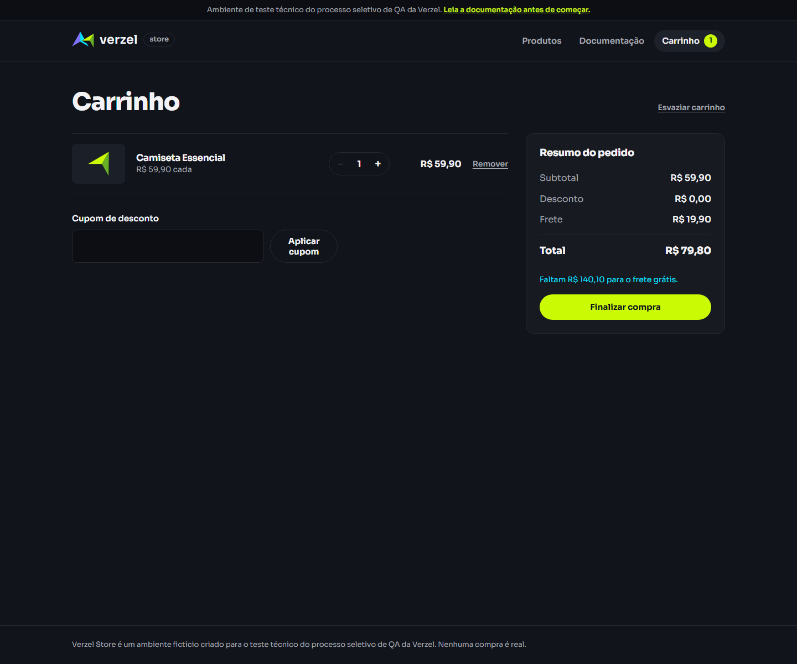

# Guia de testes da Verzel Store

## Visão geral

Este guia documenta a estratégia de testes aplicada para a loja Verzel Store, com foco em regras de negócio, interface e comportamento do carrinho.

## Documentação de referência

A documentação oficial usada como base para os testes foi a página de requisitos do ambiente:

- https://verzel-store.qa-test-verzel-store.workers.dev/documentacao

## Critérios de aceite principais

### Cupom de desconto

- `BEMVINDO10` aplica 10% de desconto sobre o subtotal
- o código do cupom ignora maiúsculas/minúsculas e espaços
- cupom inexistente exibe "Cupom inválido."
- cupom expirado exibe "Cupom expirado."
- apenas um cupom pode ser aplicado por vez
- desconto não incide sobre o frete

### Frete grátis

- compras com subtotal igual ou superior a R$ 200,00 têm frete grátis
- abaixo disso, é cobrado R$ 19,90
- o valor faltante para frete grátis é informado na interface

### Regras do pedido

- limite máximo de 5 unidades por produto
- valor total calcula como `subtotal - desconto + frete`
- valores monetários são arredondados para 2 casas decimais

## Estrutura da automação

### Playwright

A suíte de interface foi desenvolvida em `Playwright/tests/example.spec.js`.

Os testes valem:

- carregamento da loja
- disponibilidade do produto
- adição ao carrinho
- carrinho com item adicionado
- campo de cupom
- aplicação de cupom válido
- rejeição de cupom inválido
- limite de quantidade
- resumo do pedido
- início da finalização da compra

### Postman

A coleção em `postman/TESTES.postman_collection.json` ajuda a validar a API do ambiente, especialmente o cálculo do carrinho e o retorno da regra de cupom/frete.

## Regras que devem ser seguidas

É obrigatório seguir as regras abaixo durante toda a execução dos testes:

- validar somente o comportamento descrito na documentação do ambiente
- respeitar os critérios de aceite do projeto
- usar o cupom `BEMVINDO10` apenas conforme o cenário válido
- considerar que um cupom inválido ou expirado não aplica desconto
- aplicar a regra de frete grátis somente sobre o subtotal antes do desconto
- limitar a quantidade por produto em até 5 unidades
- verificar que o cálculo do total usa `subtotal - desconto + frete`
- garantir que os testes sejam executados em Chromium, Firefox e WebKit

## Boas práticas aplicadas

- uso de seletores acessíveis em vez de CSS frágil
- validação de textos reais exibidos na interface
- cuidado com elementos duplicados na página
- uso de critérios baseados na documentação de negócio
- testes executados em múltiplos navegadores

## Execução recomendada

```bash
cd Playwright
npx playwright test --reporter=line
```

## Evidência de execução

Para documentar a execução real dos testes, a equipe deve registrar:

- comando executado
- resultado final
- print ou relatório gerado

### Comando executado

```bash
cd Playwright
npx playwright test --reporter=line
```

### Resultado verificado

A execução foi validada com sucesso:

- 30 testes executados
- 30 passaram
- resultado final: aprovado

### Evidência complementar

A evidência pode ser composta por:

- screenshot do navegador durante o teste
- relatório HTML do Playwright
- log de execução do terminal

Essa infraestrutura já está disponível no projeto em `Playwright/playwright-report`.

### Prints de execução




## Observações importantes

A maior parte dos problemas encontrados não era de regra de negócio, e sim de seletor. Em páginas com múltiplos botões iguais, o Playwright exige pontaria no alvo correto. A solução foi localizar o produto específico, analisar o DOM realmente renderizado e validar o elemento correto.

Esse tipo de ajuste é parte essencial da automação com qualidade de QA.
